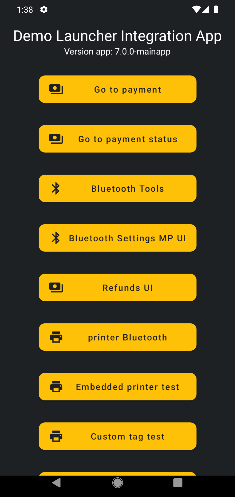
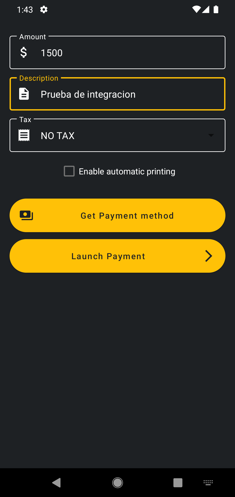
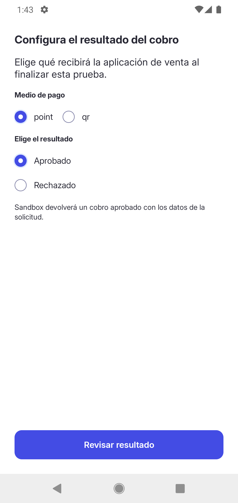

# Point SmartApp Demo — kit de integración Android

Aplicación de ejemplo para integrar una app Android con el ecosistema de pagos de Mercado Pago en terminales Point Smart. Muestra cómo inicializar el SDK, solicitar un cobro, recibir su resultado y utilizar capacidades como impresión, cámara y Bluetooth.

Este repositorio contiene el **código del demo**, con variantes MainApp y MiniApp. El **kit de integración** distribuido en Releases contiene el SDK, su documentación y los APK listos para instalar. Puedes comenzar con esos APK sin compilar este proyecto.

**Para empezar:** [descarga el kit](https://github.com/mercadolibre/point-mainapp-demo-android/releases), [elige dónde probar](#dónde-probar) y sigue la [primera prueba de cobro](#primera-prueba-de-cobro-con-sandbox).

## Contenido

- [Qué incluye el kit](#qué-incluye-el-kit)
- [MainApp y MiniApp](#mainapp-y-miniapp)
- [Dónde probar](#dónde-probar)
- [Instalar el demo y configurar Sandbox](#instalar-el-demo-y-configurar-sandbox)
- [Primera prueba de cobro con Sandbox](#primera-prueba-de-cobro-con-sandbox)
- [Otras funciones del demo](#otras-funciones-del-demo)
- [Llevar el ejemplo a tu aplicación](#llevar-el-ejemplo-a-tu-aplicación)
- [Compilar este repositorio](#compilar-este-repositorio)
- [Solución de problemas](#solución-de-problemas)
- [Documentación y contribuciones](#documentación-y-contribuciones)

## Qué incluye el kit

1. Abre [Releases](https://github.com/mercadolibre/point-mainapp-demo-android/releases).
2. Selecciona la versión que utilizará tu integración.
3. Descarga el ZIP de **Assets** y descomprímelo.

Por ejemplo, la [release 7.0.0](https://github.com/mercadolibre/point-mainapp-demo-android/releases/tag/7.0.0) publica `Kit.of.integration.smartapps.7.0.0.zip` con estos archivos:

| Archivo | Para qué sirve |
|---|---|
| `nativesdk-7.0.0.aar` | Biblioteca Android que debes incorporar a tu aplicación. |
| `documentation-mainapp-SDK-7.0.0.zip` | Referencia de clases, métodos y parámetros del SDK. Descomprímela y abre su `index.html` en el navegador. |
| `demo-mainapp-7.0.0.apk` | Demo compilado como MainApp. |
| `demo-miniapp-7.0.0.apk` | Demo compilado como MiniApp. |

Algunas entregas compartidas por el equipo de integración agregan una carpeta de **Sandbox para pruebas en emulador**, con su APK y una guía. **Sandbox no forma parte del ZIP de la release pública 7.0.0.** Si tu kit no lo incluye, solicita esa herramienta al equipo que acompaña tu integración.

Mantén el AAR, la documentación y el demo de una misma versión del SDK. Los ejemplos de este README corresponden al SDK **7.0.0** de este repositorio. Sandbox tiene su propia numeración: por ejemplo, Sandbox **1.1.0** no equivale a SDK 1.1.0. Un kit más nuevo puede incorporar APIs o pantallas distintas; utiliza su documentación correspondiente.

## MainApp y MiniApp

Las dos variantes comparten los ejemplos de este repositorio. Elige la que corresponda a la modalidad de tu integración; no necesitas instalar ambas para empezar.

| Variante | Uso en este demo |
|---|---|
| **MainApp** | Se declara también como aplicación de inicio de Android, además de poder abrirse desde el lanzador. |
| **MiniApp** | Se declara como aplicación lanzable e incluye la categoría de descubrimiento de SmartApps de Mercado Pago. |

La modalidad del demo no reemplaza la configuración ni la habilitación que pueda necesitar tu propia aplicación en una terminal física. Consulta el [playbook de Main Apps](https://www.mercadopago.com.br/developers/es/docs/main-apps/landing) para el proceso de integración y distribución.

## Dónde probar

| Entorno | Para qué utilizarlo |
|---|---|
| **Emulador Android + Sandbox** | Desarrollo local: solicitudes al SDK, resultados simulados, rechazos, cancelaciones, vista previa de impresión y lectura simulada de códigos. |
| **Terminal Point Smart física con el entorno de pagos habilitado** | Validación de los flujos reales y del hardware: lector de tarjetas, impresora, cámara, Bluetooth y servicios del fabricante. |

### Qué es Sandbox y cómo funciona

**Smart Sandbox** es una aplicación Android complementaria que se instala en el **mismo emulador y perfil de Android** que el demo o tu aplicación. Atiende las operaciones compatibles que envías mediante el SDK y permite configurar su respuesta.

```text
Demo o tu aplicación → SDK → Sandbox → resultado simulado → callback a tu aplicación
```

No necesitas apuntar a una URL de servidor de Sandbox. Su pantalla principal sirve para configurar el entorno; las operaciones se inician desde el demo o desde tu aplicación.

Los cobros de Sandbox **no mueven dinero**. Una aprobación simulada permite comprobar tu manejo del resultado, pero no valida el procesamiento financiero ni sustituye las pruebas en una terminal física. Las funciones disponibles dependen de las versiones del SDK y de Sandbox utilizadas.

### Emulador de referencia

Desde **Android Studio → Device Manager**, crea un Pixel 4 o un perfil equivalente:

| Característica | Referencia |
|---|---|
| Android | Android 12 / API 31 |
| Arquitectura | `arm64-v8a` para Apple Silicon; `x86_64` para Intel/AMD |
| Pantalla | 1080 × 2280, vertical, 440 dpi |
| Recursos del dispositivo virtual | 2 GB de RAM, 4 CPU virtuales y 10 GB de almacenamiento |
| Gráficos | Automático |

**Google Play Services y Play Store no son obligatorios para los mocks locales de Sandbox.** Usa una imagen Android compatible con la arquitectura del equipo. Los requisitos adicionales de tu propia aplicación son independientes.

Utiliza un emulador dedicado, sin módulos reales de pago que puedan competir con Sandbox por los mismos servicios o proveedores. Conserva su identidad de emulador: cambiar el nombre del modelo a N950 no agrega los periféricos de esa terminal.

## Instalar el demo y configurar Sandbox

### Instalar los APK

Puedes arrastrar los APK a la ventana de Android Emulator o instalarlos mediante Android SDK Platform Tools:

```bash
adb devices -l
adb -s emulator-5554 install -r "demo-mainapp-7.0.0.apk"
```

Ejecuta el comando desde la carpeta que contiene el APK. `emulator-5554` es un ejemplo: usa el identificador real que muestre `adb devices -l`. Para MiniApp, cambia el nombre por `demo-miniapp-7.0.0.apk`.

Para probar en emulador, instala también el APK de Sandbox que recibiste. Por ejemplo, desde la carpeta que contiene Sandbox 1.1.0:

```bash
adb -s emulator-5554 install -r "[ispi-sandbox-android]-v1.1.0-release-universal.apk"
```

### Configurar el país

1. Abre **Smart Sandbox** desde el lanzador de Android.
2. Entra en **Settings / Configuración**.
3. Selecciona el site de prueba: **MLA** (Argentina), **MLB** (Brasil), **MLC** (Chile) o **MLM** (México).
4. Pulsa **Guardar / Save** y espera la confirmación. Seleccionar un site sin guardar no aplica el cambio.
5. Abre **Demo Launcher Integration** para iniciar una operación.

El site define la moneda y las opciones disponibles del mock. No todas las combinaciones de método, cuotas e impuestos están disponibles en todos los países.

## Primera prueba de cobro con Sandbox

Para una prueba inicial, guarda el site **MLA** en Sandbox y utiliza **1500 ARS**, sin impuestos ni impresión automática.

1. En el demo, abre **Go to payment**.
2. En **Amount**, escribe `1500`. El importe se expresa en unidades de moneda, no en centavos. Para valores con decimales utiliza punto, sin separadores de miles.
3. Completa **Description**, por ejemplo `Prueba de integracion`.
4. Deja **Tax** en **NO TAX** y desmarca **Enable automatic printing**.
5. Para esta primera prueba, no selecciones un método explícito. Pulsa **Launch Payment**.
6. En Sandbox, elige un resultado **Aprobado**, pulsa **Revisar resultado** y después **Enviar resultado**.
7. Comprueba que el demo recupera el control y muestra el resultado con la referencia de pago. Conserva esa referencia para la consulta de estado.
8. Repite el flujo con un rechazo y una cancelación para comprobar también su retorno al demo.

Si quieres seleccionar un método desde el demo, pulsa **Get Payment method** y utiliza los valores devueltos por el SDK. No deduzcas los valores de una API a partir del texto de otra pantalla. Los métodos disponibles dependen del site; en Sandbox un método enviado explícitamente se muestra preseleccionado y bloqueado.

Para cancelar desde Sandbox, usa **Atrás** en la pantalla de configuración del resultado. Desde la revisión, Atrás vuelve a la configuración; la acción **Cerrar** de la revisión entrega el resultado mostrado.

**Capturas reales de referencia:** demo MainApp 7.0.0 de la release pública y Sandbox 1.1.0, ejecutados en un Pixel 4 con Android 12. Los textos del demo y de Sandbox pueden aparecer en idiomas distintos.

| Inicio del demo | Solicitud de cobro | Resultado en Sandbox |
|---|---|---|
|  |  |  |

## Otras funciones del demo

| Opción del menú | Qué puedes comprobar |
|---|---|
| **Go to payment status** | Consultar el resultado con la referencia del pago. En Sandbox, hazlo desde la misma aplicación que creó el cobro aprobado y antes de que termine el proceso de Sandbox: su historial es temporal. |
| **Embedded printer test** | Enviar una imagen a la impresora integrada. En el emulador, Sandbox muestra una aproximación térmica y solicita confirmar el resultado simulado. |
| **Custom tag test** | Probar contenido de impresión con los formatos y etiquetas admitidos por el SDK y el entorno de destino. |
| **Camera Scanner** | Iniciar lectores por callback o por las rutas mostradas en el demo. En Sandbox puedes devolver un valor simulado; la cámara requiere sus permisos y formatos compatibles. |
| **Smart info** | Consultar información de terminal, SDK y módulo de pagos. Los datos de terminal devueltos por Sandbox son sintéticos. |
| **Bluetooth Tools**, **Bluetooth Settings MP UI**, **printer Bluetooth** | Ejemplos de control, configuración e impresión Bluetooth. Requieren una terminal física compatible para validar el hardware. |
| **Refunds UI** | Ejemplo que llama a la API pública de Mercado Pago con un pago y un token autorizado. No forma parte del mock local de cobros de Sandbox. |

En Sandbox, prueba una operación a la vez y verifica el callback además de la pantalla. No cambies el site durante una operación pendiente.

### Diferencias por país y límites físicos

- **Métodos y cuotas:** consulta lo que devuelve el SDK para el site elegido. Las alternativas del mock sirven para probar la integración; no representan una oferta financiera real.
- **Impuestos:** la condición de IVA de la solicitud está soportada en Sandbox para **MLC**. En los demás sites utiliza **NO TAX**. El mock no emite documentos tributarios reales.
- **Bluetooth:** el emulador no permite probar el Bluetooth de una terminal de pago. Los flujos compatibles muestran un aviso; continúa la validación en una **N950 o A910 física compatible**, con adaptador y permisos disponibles.
- **Impresión:** una vista previa no valida papel, calidad térmica ni drivers. Sandbox puede utilizar la impresora integrada de una **N950 física compatible**; el emulador muestra una simulación.
- **Pagos reales:** tarjeta, EMV, NFC, servicios del fabricante y comportamiento financiero se validan en el entorno físico correspondiente.

## Llevar el ejemplo a tu aplicación

1. Define con el equipo de integración tu modalidad, versión del SDK y entorno de pruebas.
2. Incorpora el AAR de esa versión y sigue su documentación para las dependencias, configuración y requisitos de Android. El demo muestra una [dependencia local al AAR](app/build.gradle).
3. Revisa la [inicialización del SDK](app/src/main/java/com/mercadolibre/android/point_mainapp_demo/app/MainApplication.kt) y configura los identificadores asignados a tu aplicación. Los del demo pertenecen al ejemplo.
4. Implementa las operaciones que necesitas y el manejo de éxito, error y cancelación. Usa el demo como referencia, adaptando la lógica y la experiencia a tu aplicación.
5. Prueba primero el retorno completo con Sandbox y después las capacidades reales en la terminal de destino.

Puntos de entrada en el código:

| Ejemplo | Archivo |
|---|---|
| Menú y capacidades expuestas | [ActionsProviderImpl.kt](app/src/main/java/com/mercadolibre/android/point_mainapp_demo/app/ActionsProviderImpl.kt) |
| Solicitud de cobro y callback | [PaymentLauncherActivity.kt](app/src/main/java/com/mercadolibre/android/point_mainapp_demo/app/view/payment/launcher/PaymentLauncherActivity.kt) |
| Selección de cuotas | [PaymentFlowInstallmentsActivity.kt](app/src/main/java/com/mercadolibre/android/point_mainapp_demo/app/view/payment/launcher/PaymentFlowInstallmentsActivity.kt) |
| Consulta de estado | [PaymentStatusApprovedActivity.kt](app/src/main/java/com/mercadolibre/android/point_mainapp_demo/app/view/payment/result/PaymentStatusApprovedActivity.kt) |
| Impresión de imagen | [PrinterBitmapActivity.kt](app/src/main/java/com/mercadolibre/android/point_mainapp_demo/app/view/printer/PrinterBitmapActivity.kt) |
| Lectura de códigos | [LaunchScannerActivity.kt](app/src/main/java/com/mercadolibre/android/point_mainapp_demo/app/view/camera/LaunchScannerActivity.kt) |
| Información de terminal | [SmartInfoActivity.kt](app/src/main/java/com/mercadolibre/android/point_mainapp_demo/app/view/info/SmartInfoActivity.kt) |

## Compilar este repositorio

Si solo quieres explorar el demo, utiliza el APK del kit. Para modificar o estudiar el código:

```bash
git clone https://github.com/mercadolibre/point-mainapp-demo-android.git
cd point-mainapp-demo-android
```

Abre el proyecto en Android Studio y sincroniza Gradle. La configuración de esta rama utiliza **minSdk 23**, **compileSdk 33**, **Android SDK Build Tools 32.0.0** y el wrapper **Gradle 7.5**. Usa un JDK compatible con Android Gradle Plugin 7.4, por ejemplo **JDK 11**. El nivel de compatibilidad del código Java es 8; no equivale a la versión del JDK que ejecuta Gradle.

El AAR utilizado ya está en `app/libs/`. Para reproducir una release concreta, utiliza su tag y verifica el AAR declarado en `app/build.gradle`, en lugar de mezclar el código de una versión con el SDK de otra.

Selecciona `mainappDebug` o `miniappDebug` en **Build Variants**, o compila con el wrapper:

```bash
./gradlew :app:assembleMainappDebug
./gradlew :app:assembleMiniappDebug
```

En Windows utiliza `gradlew.bat`. Los APK se generan bajo `app/build/outputs/apk/`, separados por variante. La firma de desarrollo permite probar el demo; sigue el proceso de distribución correspondiente para tu propia aplicación.

## Solución de problemas

| Situación | Qué revisar |
|---|---|
| ADB no encuentra el dispositivo | Inicia el emulador o conecta la terminal con depuración USB autorizada. Verifica `adb devices -l` y utiliza su identificador real. |
| El demo abre pero la operación falla | En emulador, confirma que Sandbox está instalado en el mismo Android y perfil. En una terminal real, comprueba que el entorno de pagos esté habilitado. |
| El importe, método o impuesto es rechazado | Revisa el site guardado, la moneda, el formato y los valores admitidos por tu SDK. Para empezar, usa el ejemplo MLA de esta guía. |
| El pago no se encuentra al consultar estado | Conserva la referencia devuelta y consulta desde la misma variante del demo. En Sandbox, el historial no se comparte entre aplicaciones y puede perderse al terminar su proceso o reiniciar Android. |
| La instalación falla por firma incompatible | Usa un APK firmado de forma compatible o un emulador dedicado limpio; no mezcles instalaciones de procedencias distintas con el mismo identificador. |
| La instalación falla por conflicto de proveedores | Usa un emulador dedicado a Sandbox, sin módulos reales de pago que registren los mismos proveedores. |
| Bluetooth no funciona en emulador | Es una limitación esperada. Valida esa funcionalidad en hardware compatible. |
| La impresión muestra una vista previa | Es el resultado esperado en el emulador; confirma el resultado para devolverlo al demo y valida la impresión física en una terminal. |
| Gradle no sincroniza | Comprueba JDK, Android SDK, conectividad para descargar dependencias y que estés utilizando el wrapper del proyecto. |

Al reportar un problema, incluye versiones del SDK, demo y Sandbox, site, modelo/API de Android, pasos para reproducirlo y resultado esperado/observado. No incluyas tokens, credenciales ni datos personales en capturas o reportes.

## Documentación y contribuciones

- [Releases y kit de integración](https://github.com/mercadolibre/point-mainapp-demo-android/releases).
- Documentación de APIs: ZIP incluido en la versión del kit que estés utilizando.
- [Playbook de Main Apps](https://www.mercadopago.com.br/developers/es/docs/main-apps/landing).
- [Historial de cambios](CHANGELOG.md).
- [Cómo contribuir](CONTRIBUTING.md).
